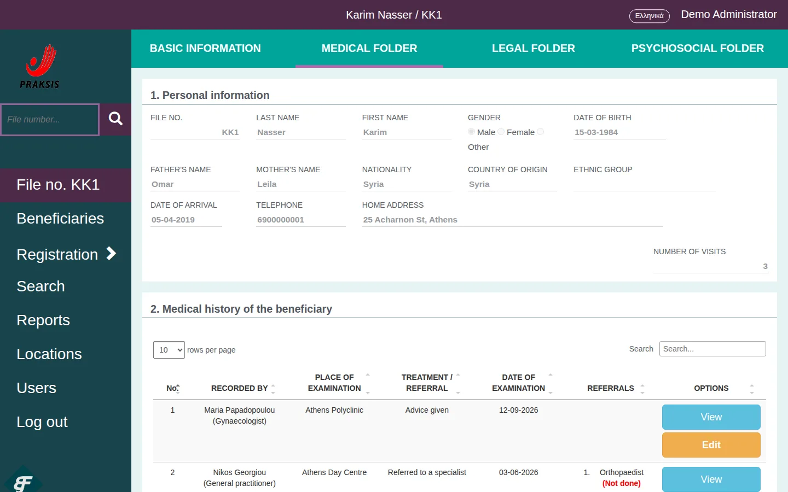
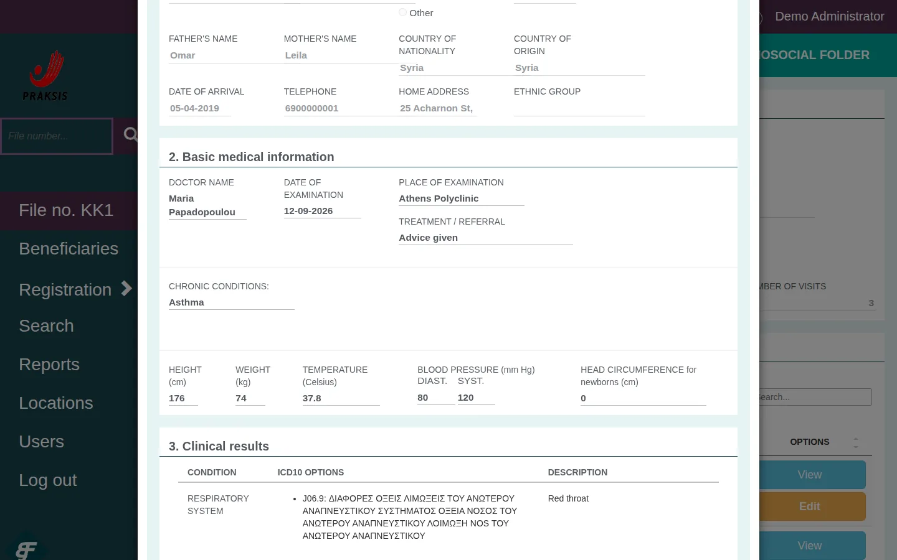

# BeneFile

**One digital file for every person you support.**

BeneFile is free, open-source software for organisations that give medical, legal and psychosocial support. Each person you support gets one file. Doctors, lawyers, social workers and psychologists work on the same file, each in their own folder, so the whole team sees the whole picture.

[Website](https://scify.github.io/Benefile/) · [Install](docs/installation.md) · [Documentation](docs/README.md)



## Why BeneFile

- **One file, four folders.** Basic information, a medical folder, a legal folder and a psychosocial folder for each person, under one file number.
- **Each role does its own work.** Doctors change medical visits, lawyers the legal folder, psychologists their sessions. Everyone can read the whole file. Session notes are only for psychologists and administrators.
- **Your data stays with you.** You install BeneFile on a server of your organisation, and the records stay there.
- **Greek and English.** Each user chooses the language of the interface.
- **Free to use and change.** Apache License 2.0.

## What it does

| Folder | What your team records |
|--------|------------------------|
| Basic information | Personal and family details, languages, legal status, education and work, referrals, incidents, and a check for possible duplicates |
| Medical folder | Medical visits with place and doctor, vital signs, diagnoses with ICD-10 codes, medication, lab results, hospital stays, referrals and files, with a print of each visit |
| Legal folder | Legal status, the asylum request and its stage, the actions of the lawyer and the legal sessions |
| Psychosocial folder | Social history, and support sessions by type of support |

Across all files:

- **Search** with many criteria together: name, age, country, legal status, doctor, place, condition, medication, dates.
- **Reports** for the team and the people you support: charts by gender, education, place, doctor and condition, and visits and registrations per month.
- **CSV** export of all files and of the history of all the work, and import of beneficiaries from a CSV file.
- **Users** register, and an administrator activates each one with their role. A user who leaves is deactivated: their work stays in the files.



## Get started

BeneFile is a Laravel application. It needs PHP 8.3 or later, MySQL 8 and Composer.

```shell
git clone https://github.com/scify/Benefile.git
cd Benefile
composer install --no-dev --optimize-autoloader
cp .env.example .env    # your database, mail server and organisation
php artisan key:generate
php artisan migrate --seed --force
php artisan benefile:create-admin
```

[Install BeneFile](docs/installation.md) has the details: the server, the production settings, and the name and logo of your organisation.

Health and legal records are sensitive data. Use HTTPS, keep backups, and install the security updates of PHP and Laravel.

## Contribute

Bug reports, ideas and pull requests are welcome. Open an [issue](https://github.com/scify/Benefile/issues) to start. [Develop BeneFile](docs/development.md) tells how to run a local copy and the tests.

## About

[SciFY](https://www.scify.org) made BeneFile, with feedback from the Greek NGO [PRAKSIS](https://www.praksis.gr).

## Licence

Apache License 2.0. See [licence](licence).
