# Brooks-Lint Review

**Mode:** Architecture Audit
**Scope:** `app/` (controllers, services, models, middleware, support), `routes/`, `database/seeders`, `resources/views` (Blade), and the project's own JavaScript in `public/js` (`records/`, `main-panel/`, `search/`, `reports/reports.js`, `importCSV/`, `forms.js`, `loginRegister/`). Third-party libraries in `public/`, `vendor/` and `node_modules/` are not in the scope. No `.brooks-lint.yaml`: all six risks are enabled.
**Health Score:** 16/100
**Trend:** First run. No trend data. (History tracking was skipped: this audit is read-only, so `.brooks-lint-history.json` was not written.)

The security layer is now sound, but the domain layer is not there: four folders share one 912-line controller, the services do all the work on anemic models and raw tables, and the medical visit logic is written twice. Every change in a folder is expensive and has no test to make it safe.

Context that this audit does not report again: the upgrade from Laravel 5.1 to 13, the security fixes (bound SQL parameters, role middleware, private medical uploads, CSV escaping), Larastan level 5, and the compatibility choices made on purpose (`app/Support/Form.php`, `legacy_count()`, MySQL strict mode off, `ConvertEmptyStringsToNull` removed).

---

## Module Dependency Graph

```mermaid
graph TD
  subgraph Entry["Routes and middleware"]
    WebRoutes["routes/web.php"]
    RoleMW["Middleware: RequireRole / IsAdministrator / IsEnabled"]
  end

  subgraph Controllers["app/Http/Controllers"]
    RecordsController["RecordsController (fan-out: 7)"]
    SearchController
    ReportsController
    UploadFileController
    UsersController
    NewLocationController
    MedicalUploadController
    AuthControllers["Auth controllers"]
  end

  subgraph Services["app/Services"]
    BasicInfoService["BasicInfoService (fan-out: 7)"]
    MedicalFolderService["BenefiterMedicalFolderService"]
    SocialFolderService
    LegalFolderService
    BenefitersService
    SearchService
    ReportsService
    UploadFileService["UploadFileService (fan-out: 6)"]
    Conversions["ConversionsForFileUpload"]
    UserService
    AddNewLocationService
    DatesHelper
    GreekString["GreekStringConversionHelper"]
  end

  subgraph Domain["app/Models"]
    EloquentModels["Eloquent models (Benefiters_Tables_Models)"]
    ViewModels["ViewModels (history rows)"]
    UserModel["User (role constants)"]
  end

  subgraph Infra["Persistence"]
    RawTables["Raw tables via DB::table / DB::select (84 calls)"]
  end

  subgraph UI["resources/views + public/js"]
    FolderViews["Blade folder forms"]
    Layout["layouts/mainPanel"]
    RecordsJS["public/js/records"]
    SearchJS["public/js/search"]
    ReportsJS["public/js/reports"]
  end

  subgraph Support["app/Support"]
    FormShim["Form (laravelcollective shim)"]
  end

  WebRoutes --> RoleMW
  WebRoutes --> RecordsController
  WebRoutes --> SearchController
  WebRoutes --> ReportsController
  WebRoutes --> UploadFileController
  WebRoutes --> UsersController
  WebRoutes --> NewLocationController
  WebRoutes --> MedicalUploadController
  WebRoutes --> AuthControllers
  RoleMW --> UserModel

  RecordsController --> BasicInfoService
  RecordsController --> MedicalFolderService
  RecordsController --> SocialFolderService
  RecordsController --> LegalFolderService
  RecordsController --> BenefitersService
  RecordsController --> DatesHelper
  RecordsController --> EloquentModels
  RecordsController --> FolderViews
  SearchController --> SearchService
  SearchController --> MedicalFolderService
  ReportsController --> ReportsService
  UploadFileController --> UploadFileService
  UsersController --> UserService
  NewLocationController --> AddNewLocationService
  MedicalUploadController --> EloquentModels
  AuthControllers --> UserModel
  AuthControllers --> RawTables

  BasicInfoService --> SocialFolderService
  BasicInfoService --> LegalFolderService
  BasicInfoService --> DatesHelper
  BasicInfoService --> GreekString
  BasicInfoService --> EloquentModels
  BasicInfoService --> ViewModels
  BasicInfoService --> RawTables
  UploadFileService --> SocialFolderService
  UploadFileService --> Conversions
  UploadFileService --> DatesHelper
  UploadFileService --> GreekString
  UploadFileService --> EloquentModels
  UploadFileService --> RawTables
  Conversions --> GreekString
  Conversions --> RawTables
  MedicalFolderService --> DatesHelper
  MedicalFolderService --> EloquentModels
  LegalFolderService --> DatesHelper
  LegalFolderService --> ViewModels
  LegalFolderService --> RawTables
  SocialFolderService --> RawTables
  SearchService --> DatesHelper
  SearchService --> RawTables
  ReportsService --> EloquentModels
  ReportsService --> RawTables
  UserService --> UserModel
  AddNewLocationService --> EloquentModels
  EloquentModels --> UserModel

  FolderViews --> Layout
  FolderViews --> DatesHelper
  FolderViews --> FormShim
  FolderViews --> UserModel
  Layout --> UserModel
  RecordsJS --> WebRoutes
  SearchJS --> WebRoutes
  ReportsJS --> WebRoutes

  classDef critical fill:#ff6b6b,stroke:#c92a2a,color:#fff
  classDef warning fill:#ffd43b,stroke:#e67700
  classDef clean fill:#51cf66,stroke:#2b8a3e,color:#fff

  class RecordsController,MedicalFolderService,EloquentModels,RawTables,BasicInfoService,LegalFolderService critical
  class UploadFileService,Conversions,SocialFolderService,SearchService,SearchJS,FolderViews,Layout warning
  class WebRoutes,RoleMW,SearchController,ReportsController,UploadFileController,UsersController,NewLocationController,MedicalUploadController,AuthControllers,BenefitersService,ReportsService,UserService,AddNewLocationService,DatesHelper,GreekString,ViewModels,UserModel,RecordsJS,ReportsJS,FormShim clean
```

There are no dependency cycles. The direction is mostly correct (controllers → services → models / tables). The problems are the size of some nodes, the missing domain layer, and that the UI layer (Blade, JS) holds rules that belong to the server.

---

## Findings

### 🔴 Critical

**Change Propagation — `RecordsController` is one controller for four bounded contexts**
Symptom: `app/Http/Controllers/MainPanel/RecordsController.php` has 912 lines and 33 actions. It serves the basic information, the psychosocial folder, the medical folder, the legal folder, beneficiary deletion and two CSV exports. Six actions are longer than 50 lines: `getBasicInfo` (63–129), `postBasicInfo` (132–191), `getMedicalFolder` (343–454, 112 lines), `postMedicalFolder` (457–560), `getMedicalVisitModal` (563–660), `getMedicalVisitForEditing` (663–771). `getMedicalVisitModal` and `getMedicalVisitForEditing` contain the same 45-line loop that collects a visit's data. The constructor creates five services with `new` (41–54). It imports 13 models that it does not use (6–19).
Source: Fowler — Refactoring, Divergent Change and Long Method; McConnell — Code Complete, Ch. 7 High-Quality Routines.
Consequence: a change for doctors, lawyers or psychologists opens the same file. Merge conflicts and regressions in a folder that the change did not touch become probable. The duplicated visit loop already differs (one returns IDs, one returns descriptions), so a new visit field must be added in two places, and it is easy to forget one.
Remedy: split by folder into `BasicInfoController`, `SocialFolderController`, `MedicalFolderController` (with `MedicalVisitController` for show/edit/update), `LegalFolderController`, and `BeneficiaryExportController` (the two CSV downloads). Move the visit-collection loop into one method, for example `MedicalFolderService::visitDetails(int $benefiterId, int $visitId): array`, and use it for the modal and for the edit form. Do this after the characterization tests of the Warning "No seams" (below). Larger refactor; the route file changes only in the controller class names.

**Knowledge Duplication — the medical visit is written by two parallel algorithms, without a transaction**
Symptom: `app/Services/BenefiterMedicalFolderService.php` (1406 lines) has `save_new_medical_visit_tables` (153–175) with ten `save_*` methods, and `update_medical_visit_tables` (503–525) with ten `update_*` methods. Seven `update_*` methods (chronic conditions 542, examination results 620, laboratory 710, diagnosis 770, hospitalizations 830, medication 885–1085, referrals 1086, uploads 1147) each re-implement the same positional "update the first N saved rows, insert or delete the rest" algorithm. Together this is about 690 lines. The write touches up to ten tables, and there is no `DB::transaction` (the TODO at line 151 says so). `update_medical_visit` (528–540) takes `benefiter_id` and `doctor_id` from the request, so the edit can move a visit to a different beneficiary or doctor.
Source: Hunt & Thomas — The Pragmatic Programmer, DRY; Fowler — Refactoring, Duplicate Code.
Consequence: a new field or a rule change in a visit section must be made in a `save_*` and an `update_*` method, and the two copies already differ. If one table write fails, the visit stays half-saved, which is an integrity problem in a medical record. The positional matching also gives wrong history: when a doctor removes the first of three diagnoses, the rows are rewritten, not deleted.
Remedy: (1) Wrap both public methods in `DB::transaction()` — a safe mechanical fix. (2) Read `benefiter_id` from the route and the visit, never from the request, and keep `doctor_id` unchanged on update. (3) Replace the seven `update_*` methods with one strategy: delete the visit's child rows and insert them again through the same `save_*` methods (the child rows have no own identity that other tables use), or a generic `syncChildren(medical_visits $visit, string $relation, array $rows)`. (4) Add `hasMany` relations on `medical_visits` (chronicConditions, labResults, diagnoses, hospitalizations, medications, referrals, uploads, examination) so the sync can use `$visit->labResults()->delete()` / `createMany()`. Larger refactor; needs characterization tests first.

**Domain Model Distortion — the folders have no domain model; relations are rebuilt by hand**
Symptom: the beneficiary's folders and their parts have no model: `social_folder`, `legal_folder`, `asylum_request`, `legal_section_status`, `benefiters_legal_status`, `benefiters_languages`, `legal_lawyer_action`, `work_title_list_lookup` are used only through `DB::table(...)` (84 `DB::` calls in seven services and `RegisterController`). The models that exist carry almost no behaviour and few relations. `Benefiter::medical_visits()` has its keys reversed (`app/Models/Benefiters_Tables_Models/Benefiter.php:64`, `hasMany(medical_visits::class, 'id', 'benefiter_id')`), yet `BenefitersService::getAllBenefiters()` eager-loads it. Instead of relations, the services find a user, role, subrole or location by array position `id - 1`: `BasicInfoService.php` 606–674 (24 places), `LegalFolderService.php` 205–207 and 224, and `BenefiterMedicalFolderService::reindex_array()` (1231) builds every location and incident-type dropdown on the assumption that the IDs are 1..n without gaps. The legal-status form fields are indexed the same way (`BasicInfoService.php` 172, 424–425).
Source: Evans — Domain-Driven Design, Domain Model pattern (Anemic Domain Model) and Aggregate Roots; Ousterhout — A Philosophy of Software Design, Ch. 5 Information Leakage.
Consequence: the decision "an ID equals its position plus one" is encoded in about 30 places and in the seeders' insert order. When an administrator deletes or deactivates a user, or a location gets a non-contiguous ID, the history and the forms show the wrong person, profession or place, or fail with an undefined index — in a medical and legal record, without any error message. Without models, there is no single owner of the rules of a folder, so the rules stay in the services and in the views.
Remedy: create the missing Eloquent models (`SocialFolder`, `LegalFolder`, `AsylumRequest`, `LegalSectionStatus`, `BenefiterLegalStatus`, `BenefiterLanguage`, `LawyerAction`, `WorkTitle`) with the existing table names in `$table`. Add relations on `Benefiter` (`socialFolder`, `legalFolder`, `legalStatuses`, `languages`, and a corrected `medicalVisits(): hasMany(medical_visits::class, 'benefiter_id')`), and `user()`/`location()` belongsTo relations on `BasicFolderHistory`, `LegalSession`, `PsychosocialSession`, `medical_visits`. Then replace each `$users[$x->user_id - 1]` with `$x->user` (eager-loaded with `with('user.role', 'location')`), and replace `reindex_array()` with `->pluck('description', 'id')`. The relation fix in `Benefiter.php:64` is a safe mechanical fix; the rest is a step-by-step refactor, one folder at a time.

### 🟡 Warning

**Knowledge Duplication — the authorization rules are written twice, and the copies already disagree**
Symptom: the routes use `User::ROLE_*` and the `role:` middleware (`routes/web.php` 27–31). The views and one service compare `user_role_id` with the literals 1–5 in 19 places: `layouts/mainPanel.blade.php` 79, 86, 98, 103; `partials/forms/social_folder_form.blade.php` 147, 159, 174, 277, 283; `partials/forms/legal_folder_form.blade.php` 16, 367; `partials/forms/medical-visit/new_medical_visit.blade.php` 232, 237, 264; `medical_visit_edit.blade.php` 48; `basic_info_form.blade.php` 23; `benefiters_list.blade.php` 49; `app/Services/BasicInfoService.php` 666. The copies differ: the route lets social workers and psychologists save the social folder, but the view shows the save button only to role 4 (`social_folder_form.blade.php` 147, 159); `legal_folder_form.blade.php` 367 checks the psychologist role inside the legal folder. `app/Policies/` is empty.
Source: Hunt & Thomas — The Pragmatic Programmer, DRY; Fowler — Refactoring, Magic numbers (McConnell — Code Complete, Ch. 12).
Consequence: a change to who can do what must be made in the routes and in up to nine views. The server stays safe, but users see buttons that give 403, or do not see buttons for actions they may do.
Remedy: define one gate per action in `AppServiceProvider::boot()` (for example `Gate::define('edit-medical-folder', fn (User $u) => $u->hasRole(User::ROLE_DOCTOR))`, and the same for legal, social history, psychosocial sessions, administration). Use `->can('edit-medical-folder')` in `routes/web.php` and `@can('edit-medical-folder')` in Blade. In `BasicInfoService.php:666`, use `$user->hasRole(User::ROLE_PSYCHOLOGIST)`. Safe mechanical fix, but check each view against the route first, because some copies are wrong today.

**Knowledge Duplication — "register a beneficiary" is implemented twice**
Symptom: the form path is `BasicInfoService::saveBasicInfoToDB` (76–107) with `saveLanguagesToDB` (313), `saveLegalStatusesToDB` (410) and `getLegalStatusArrayForDBInsert` (421). The CSV import path is `UploadFileService::selectAppropriateDBTableForEachFileRowColumns` (127–149, raw `DB::table('benefiters')->insertGetId`), `getLanguagesArrayForDBInsert` (336), `insertLegalStatusToDBFromFile` (379) and its own `getLegalStatusArrayForDBInsert` (416), plus `ConversionsForFileUpload`. The invariant "every beneficiary has a psychosocial folder" is enforced by each caller (`BasicInfoService.php:102`, `UploadFileService.php:132`). `BasicInfoService::getFoldersUsageHistory` reads `->id` on that folder without a null check (567).
Source: Hunt & Thomas — The Pragmatic Programmer, DRY; Evans — Domain-Driven Design, Aggregate Roots.
Consequence: a new beneficiary field or rule must be added in two services, and imported beneficiaries already differ from typed ones (no update history, legal status without details). If a third path creates a beneficiary without the social folder, the basic info page fails.
Remedy: create one `BeneficiaryRegistrar` service (or `Benefiter::register(array $data)`), with `addLanguages()` and `addLegalStatuses()`, and call it from both the form and the import. Create the social folder in a `Benefiter::created` model event, or inside the registrar, not in the callers. Keep `ConversionsForFileUpload` as the import's translation layer (it maps CSV text to IDs). Larger refactor.

**Change Propagation — the controller-view contract is a set of loose session keys and `with()` variables**
Symptom: `RecordsController::getMedicalFolder` reads 17 session keys one by one and passes 29 variables to the view (345–452). `postMedicalFolder` flashes about 25 keys on failure (504–543), and many are never read (`benefiter`, `benefiter_folder_number`, `benefiter_medical_history_list`, `doctor_id`, `new_medical_location`). `getMedicalVisitForEditing` passes a key named with a literal dollar sign, `'$benefiter_medical_visits_list'` (770). The visit result is a magic number 0/1/2/3 (`visit_submited_succesfully`, 346, 503, 546, 790). `getBasicInfo` and `postBasicInfo` do the same with `legalStatuses`, `benefiter_languages` and a list of 28 copied fields (138–168).
Source: Ousterhout — A Philosophy of Software Design, Ch. 5 Information Leakage; McConnell — Code Complete, Ch. 12 (magic numbers).
Consequence: a new form field must be added in the POST action, the session read, the `with()` list and the Blade form. A typo (like the `$` key) fails silently: the view gets null and nobody sees an error.
Remedy: on validation failure, use `->withInput()` (the whole request) and read the values in Blade with `old('field')`; delete the manual session read/forget code and the unused flashed keys. Replace the 0/1/2/3 status with a PHP enum (`VisitSaveResult`) or with the standard `success`/`errors` flash. Fix the `'$benefiter_medical_visits_list'` key. Mostly mechanical, per form.

**Change Propagation — `BasicInfoService` has five reasons to change**
Symptom: `app/Services/BasicInfoService.php` (832 lines) holds basic info validation and persistence, referrals (468–510), occurrences (512–547), the cross-folder usage history (549–700, which reads the legal, medical and psychosocial folders), duplicate detection (701), and two CSV exports (722–830). It creates `SocialFolderService`, `LegalFolderService` and `GreekStringConversionHelper` with `new`. `formatAllBenefitersToCSVFile` calls `getFoldersUsageHistory` once per beneficiary (826), and each call loads all users, locations, roles and subroles again (575–581).
Source: Martin — Clean Architecture, Single Responsibility Principle; Fowler — Refactoring, Divergent Change.
Consequence: a change in any folder can break the basic information page or the exports. The export time grows with beneficiaries × users, so the download will time out as the data grows.
Remedy: move the code into `ReferralService`, `OccurrenceService`, `FolderHistoryService` (usage history, built with the relations of the Critical "no domain model" finding), and `BeneficiaryCsvExporter` (both exports; get the latest update date with one grouped query, not per row). `BasicInfoService` keeps only the basic information. Larger refactor, but each extraction is a move of private methods.

**Knowledge Duplication — the beneficiary header and the medical visit sections are copied between views**
Symptom: the read-only beneficiary header (folder number, names, gender radios, dates, telephone, address, children) is copied in `partials/forms/social_folder_form.blade.php` (32–130), `partials/forms/legal_folder_form.blade.php` (28–130, and part of it again near 540–555), `partials/forms/medical-visit/new_medical_visit.blade.php` (26–125) and `medical_visit_edit.blade.php` (58–160). Each copy creates `new \app\Services\DatesHelper()` and overwrites `$benefiter->birth_date` with a display string (for example `legal_folder_form.blade.php` 2–13). The medical visit sections exist three times: `medical_visit_partial_form.blade.php` (639 lines), `medical_visit_edit.blade.php` (845 lines) and `partials/modals/medical_visit_info.blade.php` (506 lines). `basic_info_form.blade.php` is 2095 lines with 58 `<?php` blocks.
Source: Fowler — Refactoring, Duplicate Code; Hunt & Thomas — The Pragmatic Programmer, DRY.
Consequence: a new beneficiary field or visit section must be added in three or four views, and the copies drift. Views that change model attributes for display can save the wrong value if the model is saved later in the same request.
Remedy: create a Blade component `<x-beneficiary-header :benefiter="$benefiter" />` and use it in the four forms. Give `Benefiter` `date` casts for `birth_date` and `arrival_date` and a display accessor (or a `@date` Blade directive), and remove `new DatesHelper()` from the views. Then make the visit sections into components that take a mode (`create`, `edit`, `show`), one section at a time. The header component is mechanical; the visit sections are a larger refactor.

**Change Propagation — the search results expose the raw table shape to the browser**
Symptom: `SearchService::searchBenefiters` returns `select b.*` plus joined columns (`app/Services/SearchService.php` 20), and `SearchController::getResults` sends it as JSON. `public/js/search/search.js` `DisplayResults` (170–186) builds the table HTML by string concatenation from about 25 raw column names, and re-implements the date format (`FormatDateCorrectly`, 222) and the yes/no mapping (`GetYesOrNoTextFromId`) that `DatesHelper` and `BasicInfoService::getYesOrNoTextFromId` already have. The values are not escaped before they go into the HTML.
Source: Winters et al. — Software Engineering at Google, Ch. 1 Hyrum's Law; Ousterhout — A Philosophy of Software Design, Ch. 5 Information Leakage.
Consequence: a renamed or new column in `benefiters` breaks the search page or silently sends more personal data (for example `social_history`) to every user who searches. A name with `<` in it breaks the row, and a stored script runs in the browser of the user who searches.
Remedy: return an explicit, named shape from the server — a `BeneficiarySearchResource` (JSON resource) with only the columns the table shows, already formatted. Better: render the rows server-side with a Blade partial and return HTML, which also removes `FormatDateCorrectly` and `GetYesOrNoTextFromId` from the JS. If the JS rendering stays, build cells with `textContent`, not string HTML. Medium refactor.

**Testability — no seams at the service boundary, and no tests for the risky paths**
Symptom: 27 places create services or helpers with `new` (controller constructors, `BasicInfoService` 30/102/558/566, `UploadFileService` 25–26, and seven Blade views). Services read the logged-in user themselves (`BenefiterMedicalFolderService` 1248, 1291; `BasicInfoService` 666). The tests are three feature files about access and data security (`tests/Feature`) and one Playwright screen test. No test covers the medical visit save/update, the CSV import, the usage history or the exports.
Source: Feathers — Working Effectively with Legacy Code, Ch. 4 The Seam Model and Characterization Tests.
Consequence: the three Critical refactors above cannot be done safely today: there is no way to replace a collaborator, and no test tells when the behaviour changes.
Remedy: (1) Before any refactor, write characterization feature tests for `POST benefiter/{id}/medical-folder`, `POST benefiter/{id}/editMedicalVisit` (add, change and remove rows in each section), `POST new-benefiter/uploadCSV` with a small fixture, and both CSV downloads. (2) Use constructor injection (`public function __construct(private BasicInfoService $basicInfo)`); Laravel resolves the services without any binding. (3) Pass the acting `User` as a parameter to the service methods that need it. Mechanical, file by file.

### 🟢 Suggestion

**Accidental Complexity — dead code, lazy classes and stale imports**
Symptom: six models have no user: `Work_type_lookup`, `Work_status_lookup`, `Reference_lookup`, `Language_level_lookup`, `Marital_status_lookup`, `Legal_status_lookup` (their tables are read with `DB::table` instead). `BenefitersService` (11 lines) wraps one query. `RecordsController::fetch_medical_visits_data` (811) has no route. `BenefiterMedicalFolderService` has pairs that do the same thing: `examinationsResultsLookup`/`get_medical_examination_results_from_lookup`, `findDoctorId`/`get_logged_in_user_id`, `medicalLocationsLookup`/`getAllMedicalLocations`, `benefiter_medical_visits_number`/`count_medical_visits_for_a_benefiter`. A production service imports a dev package class (`use Mockery\CountValidator\Exception;`, `BenefiterMedicalFolderService.php:23`) and a facade that no longer exists (`Illuminate\Support\Facades\Input`, 21). `resources/views/auth/email.blade.php` extends `layouts.app`, which does not exist. `public/js/loginRegister/loginRegister.js` is empty. Large commented-out blocks remain (`UploadFileController.php` 40–62, `RecordsController.php` 252–272).
Source: Fowler — Refactoring, Lazy Class and Speculative Generality; McConnell — Code Complete, Ch. 5 Design in Construction.
Consequence: readers must check each of these to learn that it does nothing. The Mockery import breaks the day `composer install --no-dev` and a `catch (Exception $e)` meet in that file.
Remedy: delete the six models (or use them in place of the `DB::table` calls, as part of the Critical model finding), inline `BenefitersService` into the list controller, delete `fetch_medical_visits_data`, keep one method of each duplicate pair, delete the stale imports, `auth/email.blade.php`, the empty JS file and the commented-out blocks. Safe mechanical fix.

**Domain Model Distortion — the code language differs from the domain language**
Symptom: the code says "benefiter" (comments and the README say "beneficiary"); classes mix styles (`medical_visits`, `BenefiterReferrals_lookup`, namespace `Benefiters_Tables_Models`); misspellings are frozen into routes and identifiers (`benefites-VS-…`, `phycological`, `examResultLoukup`, `visit_submited_succesfully`, `MedicalExaminaitonsSeeder`); the partner name "PRAKSIS" is hard-coded in 75 places (`supply_from_praksis`).
Source: Evans — Domain-Driven Design, Ubiquitous Language.
Consequence: new developers must learn a private vocabulary and search for several spellings of one concept. The partner name makes the system hard to give to another organisation.
Remedy: rename the model classes to singular PascalCase in `App\Models` (`MedicalVisit`, `BeneficiaryReferral` …) and keep the table names in `$table`. Rename `supply_from_praksis` to `supplied_by_organisation` in code, with the label in `lang/`. Rename the report routes and keep the old URLs as `Route::redirect` until the JS is updated. Mechanical with IDE refactoring, but it touches many files: do it after the controller split.

**Knowledge Duplication — repeated chart and select2 code in the project JS**
Symptom: `public/js/reports/reports.js` has six functions (8, 85, 140, 194, 280, 338) that each repeat `$.ajax` + `AmCharts.makeChart` with near-identical options. `public/js/records/medical_visit.js` configures the same select2 AJAX search twice (9–60 and 280–330).
Source: Fowler — Refactoring, Duplicate Code.
Consequence: a chart style change or a select2 upgrade needs six or two edits.
Remedy: one `renderSerialChart(url, elementId, valueField, categoryField)` in `reports.js`, and one `createAjaxSelect2($el, url)` in `medical_visit.js`. Safe mechanical fix.

**Cognitive Overload — dates are parsed by hand, with a mixed return type**
Symptom: `app/Services/DatesHelper.php` parses `dd-mm-yyyy` with `strtok` (9–23) and returns a `Carbon` or `""`. `getFinelyFormattedStringDateFromDBDate` (42–58) cuts strings with `substr` and returns nothing on empty input. The helper is called 72 times, including from views.
Source: McConnell — Code Complete, Ch. 7 High-Quality Routines; Fowler — Refactoring, Primitive Obsession.
Consequence: each caller must know that the result can be a Carbon, `""` or null. A wrong date format gives `""` silently, which the database then stores as an empty date (strict mode is off on purpose).
Remedy: use `Carbon::createFromFormat('d-m-Y', $value)` inside a `try`, return `?Carbon`, and give the models `date` casts so the views format with `$benefiter->birth_date?->format('d-m-Y')`. Mechanical, after the view header component.

---

## Summary

The most important action is to write characterization tests for the medical visit save/update, the CSV import and the exports, and then to wrap the medical visit writes in a transaction and replace the seven positional `update_*` copies with one sync strategy. After that, give the folders real Eloquent models and relations, which removes the `id - 1` lookups, and split `RecordsController` and `BasicInfoService` by folder. The trend is positive at the edges (routes, middleware, security, static analysis are now clean), but the core still has the shape of the 2016 code, and every feature change pays for it.

Conway's Law check: skipped. The team structure is not known; the repository appears to be maintained by one team, so a mismatch between modules and teams cannot be assessed.
